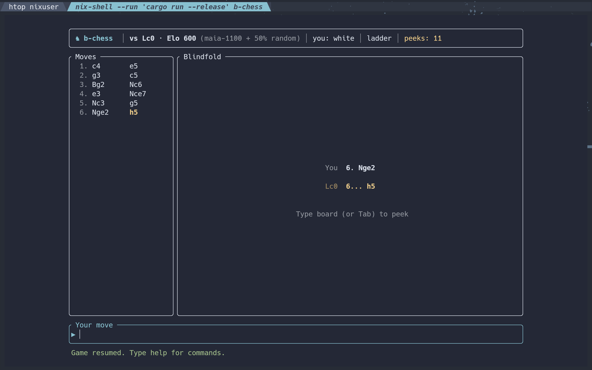
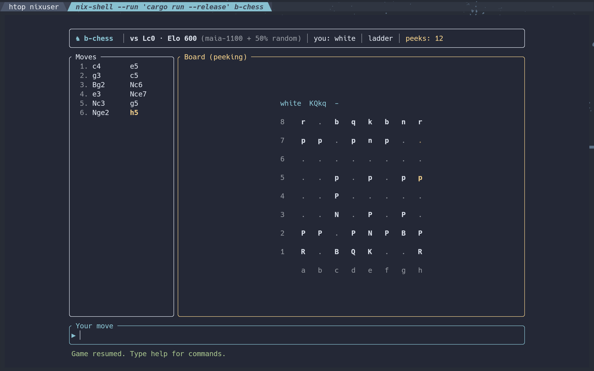
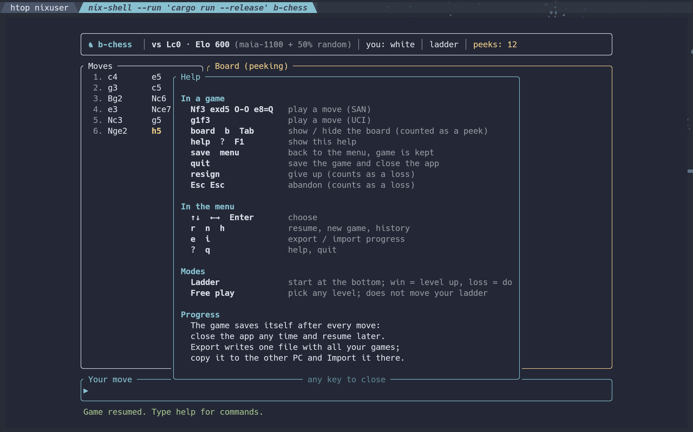

<div align="center">

# ♞ b-chess

**A blindfold chess trainer for the terminal.**

Play against [Lc0](https://lczero.org) from ~600 to ~3000 Elo without seeing the board,
climb a ladder one win at a time, and peek only when you really need to.


</div>

---

## Screenshots

**Blindfold**: you see only the moves.



**Peeking**: `board` shows a gnuchess-style board; the last move is highlighted.



**Help**: every command, one keypress away.



## Features

- **Blindfold by default**: you see the moves, not the board. Type `board` (or press Tab) to peek; peeks are counted.
- **Two modes**
  - **Ladder**: start at the bottom; a win moves you up a level, a loss moves you down.
  - **Free play**: pick any level. Recorded, but doesn't move your ladder.
- **Play as white, black or random.**
- **Human-like opponents**: the [Maia](https://maiachess.com) networks are trained on real games at each rating, so they make the kind of mistakes people make at that level.
- **Saves itself**: every move is saved, so you can close the app and resume later.
- **Take your progress with you**: export everything to one file and import it on another PC.
- **History**: date, level, color, result, moves and peeks of every game.

## Levels

| Elo | Opponent |
|---|---|
| 600 – 1000 | `maia-1100` mixed with 50% → 10% random moves |
| 1100 – 1900 | `maia-1100` … `maia-1900`, raw policy (1 node), as Maia is meant to play |
| 2000 – 2100 | `maia-1900` with 16 / 64 nodes of search |
| 2200 – 3000 | Leela `T1-256x10` with 1 → 256 nodes |

Only the Maia ratings (1100–1900) come from the networks themselves. The other levels are rough estimates that haven't been calibrated with matches.

## Install

**Nix / NixOS**: one command, Lc0 included:

```sh
nix profile install github:iamalisson/b-chess   # install
nix run github:iamalisson/b-chess               # or just try it
```

Or add `inputs.b-chess.url = "github:iamalisson/b-chess";` to your flake and put
`b-chess.packages.${system}.default` in `environment.systemPackages` / `home.packages`.

**Other systems:**

**1. Get [Lc0](https://github.com/LeelaChessZero/lc0)** on your `PATH`:

| System | How |
|---|---|
| NixOS / Nix | `nix develop` or `nix-shell` in this repo |
| Arch | `yay -S lc0` |
| macOS | `brew install lc0` |
| Others | [build or download a release](https://github.com/LeelaChessZero/lc0/releases) |

**2a. Linux binary**: grab `b-chess-*-x86_64-linux.tar.gz` from
[Releases](https://github.com/iamalisson/b-chess/releases) (static, runs on any x86_64 distro):

```sh
tar xzf b-chess-*-x86_64-linux.tar.gz
./b-chess
```

**2b. From source** (needs [Rust](https://rustup.rs)):

```sh
git clone https://github.com/iamalisson/b-chess && cd b-chess
cargo run --release
```

On first run b-chess downloads the networks (Maia 1100–1900 + Leela T1, ~50 MB) with `curl`.
Networks and progress live in `~/.local/share/b-chess` (or in the repo folder when run from source).

`LC0=/path/to/lc0`, `MAIA_DIR=/path/to/weights` and `B_CHESS_HOME=/path` override the defaults.

> **Speed:** levels up to 2100 answer instantly. From 2200 up, the big network runs on the CPU,
> and a build with only the Eigen backend can take several seconds per move at 2800+.
> A GPU or oneDNN/BLAS build of Lc0 makes this much faster.

## How to play

Moves use standard algebraic notation (SAN):

| Type | Means |
|---|---|
| `e4` `d5` | pawn move: just the square it goes to |
| `Nf3` `Bb5` `Qh5` | piece letter + square: **K**ing, **Q**ueen, **R**ook, **B**ishop, k**N**ight |
| `exd5` `Nxe5` | `x` is a capture; a capturing pawn names its file |
| `Nbd7` `R1e2` | two pieces can reach the square? add the file or rank they come from |
| `O-O` `O-O-O` | castle short / long (`0-0` works too) |
| `e8=Q` | promote a pawn |
| `e2e4` | or just type from-square + to-square |

| Where | Keys / commands |
|---|---|
| Game | `Nf3` `exd5` `O-O` `e8=Q` (SAN) or `g1f3` (UCI) |
| | `board` / `b` / Tab: show or hide the board |
| | `help` / `?` / F1: all commands |
| | `save`: back to the menu (game kept) · `quit`: save and exit |
| | `resign` · Esc Esc: abandon |
| Menu | ↑↓ Enter · `r` resume · `n` new · `h` history · `e` export · `i` import · `b` background · `q` quit |

**Background:** `b` in the menu cycles `dark` → `black` → `none` (`none` keeps your terminal's own
background). For any other color, put `background<TAB>#rrggbb` in `data/settings.tsv`.

## Progress & changing PCs

Progress lives in `data/` inside `~/.local/share/b-chess` (or the repo, gitignored):

- `data/history.tsv`: one line per finished game
- `data/saved.tsv`: the game in progress

**Export progress** writes a single text file (default `~/b-chess-progress.txt`).
Copy it to the other machine and choose **Import progress** there.

## Built with

| | |
|---|---|
| [Rust](https://www.rust-lang.org) | language |
| [ratatui](https://ratatui.rs) + [crossterm](https://github.com/crossterm-rs/crossterm) | terminal UI |
| [shakmaty](https://github.com/niklasf/shakmaty) | chess rules, SAN/UCI parsing, repetition detection |
| [Lc0](https://lczero.org) | neural-network chess engine, spoken to over UCI |
| [Maia Chess](https://github.com/CSSLab/maia-chess) | human-like networks, 1100–1900 |
| [Leela T1-256x10](https://lczero.org/play/networks/bestnets/) | strong network for 2200–3000 |
